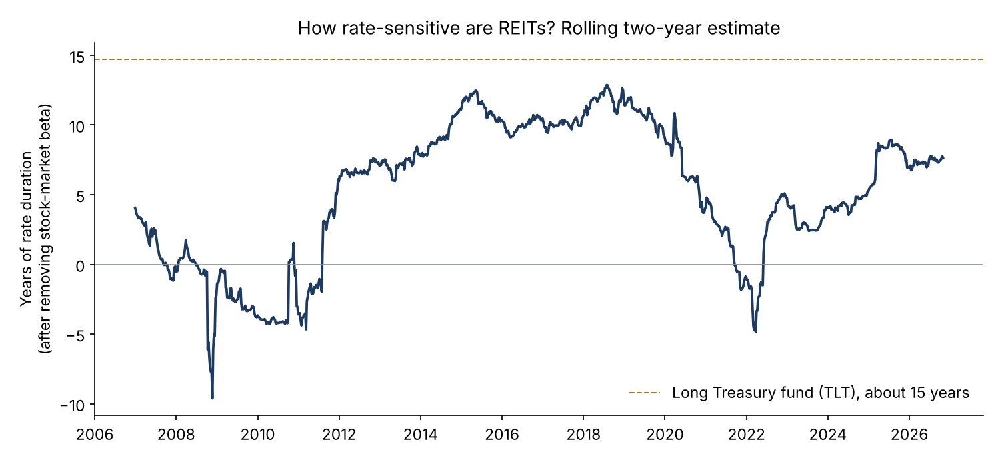
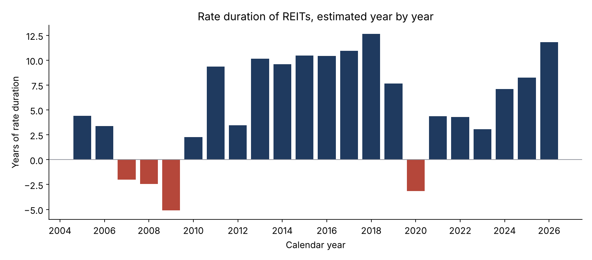
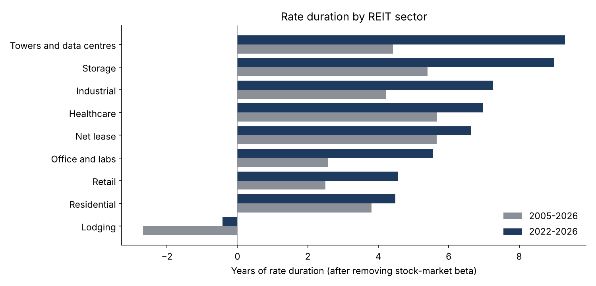
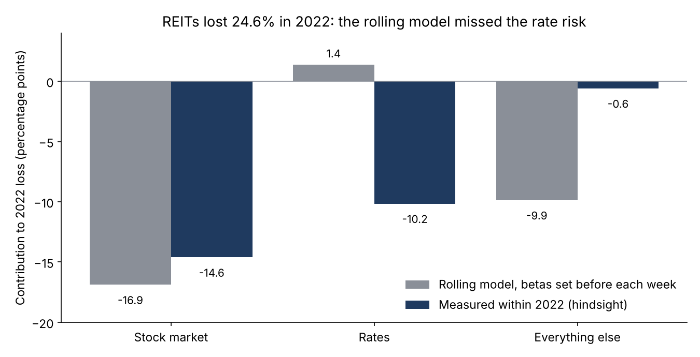
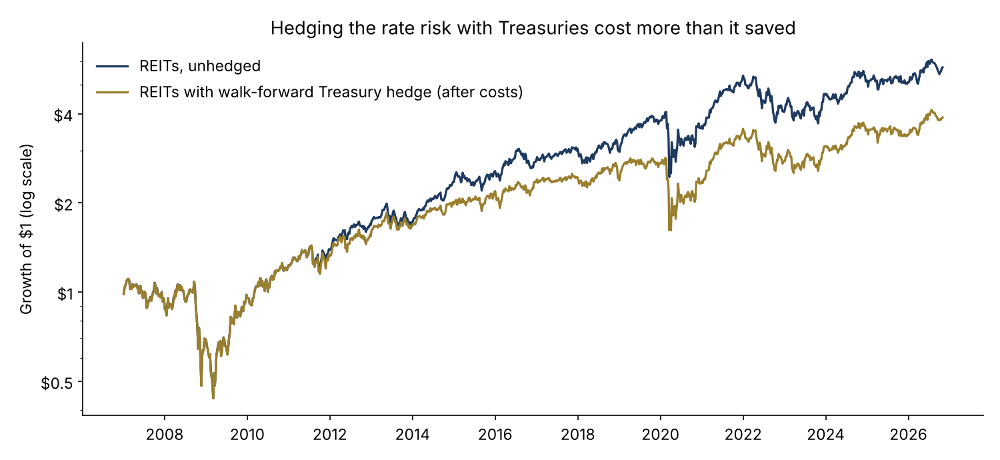

# Are REITs bonds in disguise? Rate risk in listed real estate, 2005–2026

 

**Question.** How much of a listed real estate (REIT) allocation is really interest-rate risk, and should an allocator hedge it with Treasuries?

**Answer, on real data.** An equal-weight index of 24 large US REITs across nine sectors, weekly total returns from January 2005 to October 2026 (1,139 weeks), regressed on the S&P 500 (SPY) and the weekly change in the 10-year Treasury yield.

- **The rate exposure is real, and it switched on after 2012.** After removing stock-market beta, REITs carried 0.3 years of rate duration in 2005–2012 (t −0.1), 8.7 years in 2013–2021 (t −7.9) and 6.1 years in 2022–2026 (t −5.1). A long Treasury fund (TLT) carries about 14.7.
- **In dollars.** At the 2022–2026 estimate, a $1bn REIT sleeve behaves like about $611,000 of DV01, or $61m per 100bp: roughly $416m of TLT exposure that does not show in a bond-only duration report.
- **2022: rates cost about 10 points.** REITs lost 24.6% (S&P 500 −18.2%, TLT −31.2%, 10-year yield +236bp). Measured within the year, the stock market explains −14.6 points and rates −10.2. A rolling model estimated before each week saw no rate risk going in (hedge ratio 0.0 in Q1 2022).
- **A mechanical Treasury hedge did not pay.** A walk-forward hedge (prior 104 weeks only, 5bp costs) cut annual return from 9.2% to 7.1% over 2007–2026 and did not reduce volatility (25.9% to 26.2%).
- **A fixed policy hedge is a rate view.** A ratio fixed from 2013–2021 data (0.51 of TLT per $1 of REITs) cut the 2022 loss to −9.5% and lifted 2022–2026 return from 1.3% to 5.5% a year, but the same hedge cost 3.1 points a year in 2013–2021.

Full write-up: https://www.guptagaurav.info/articles/are-reits-bonds-in-disguise







## Method

- **Universe.** 24 large REITs that trade today, grouped into nine sectors (see `configs/default.yaml`); equal-weight index rebalanced weekly across the names trading that week. Today's constituents carry survivorship bias, which inflates average returns more than it changes betas.
- **Returns.** Daily total return = (close + dividend) / prior close − 1, compounded to Friday-to-Friday weeks. The rate factor is the weekly change in the 10-year constant-maturity yield, in basis points.
- **Rate duration.** REIT return = a + b·SPY + c·Δ10y; rate duration = −c × 10,000 (years). Newey–West (4 lags) t-statistics. Estimated by period, calendar year and sector.
- **Walk-forward hedge.** Each week, estimate the model and TLT's yield sensitivity on the prior 104 weeks only, short TLT to zero the estimated rate beta (capped at 0 to 1.5), hold one week, charge 5bp on hedge turnover. A unit test checks that changing a future return never changes an earlier hedge ratio.
- **Policy hedge.** Ratio fixed from 2013–2021 estimates, tested out of sample on 2022–2026 and, for honesty, applied back to 2013–2021.
- **2022 attribution.** Ex ante: weekly betas from the walk-forward model. In-year: a regression on 2022 weeks only (hindsight).

## The commercial case

| Element | What it is |
|---|---|
| Who pays | Pension, insurance and endowment CIOs and risk teams with listed real estate sleeves; multi-asset PMs; real-asset risk teams at asset managers |
| The problem in dollars | A $1bn REIT sleeve carries about $611k of DV01 ($61m per 100bp) that a bond-only duration report misses (2022–2026 estimate) |
| The product | A real-asset rate-exposure monitor: rolling and regime-aware rate duration per sleeve and sector, DV01 in dollars, and stress losses fed into the total-portfolio duration budget |
| Proof | 22 years of weekly data, walk-forward test, out-of-sample policy-hedge test |
| Build vs buy | 3–4 weeks to connect to a client's holdings; alternatives are vendor factor models that report REITs as equity beta |
| Pricing logic | $50–100k a year per client (illustrative): small against a 100bp shock of $61m per $1bn |
| Adoption risk | Rate sensitivity changes by regime; present ranges, not a single number |
| KPI | Total-portfolio duration matches realised rate sensitivity in rate shocks |

## Data and citations

Data
- Daily prices, dividends and Treasury par yields: [huggingface.co/datasets/defeatbeta/yahoo-finance-data](https://huggingface.co/datasets/defeatbeta/yahoo-finance-data) (ODC-BY), pinned by sha256 in `configs/default.yaml` (downloaded 1 Nov 2026).

Methods
- Sweeney, R. J. and Warga, A. D. (1986). "The Pricing of Interest-Rate Risk: Evidence from the Stock Market." *Journal of Finance* 41(2), 393–410.
- Newey, W. K. and West, K. D. (1987). "A Simple, Positive Semi-Definite, Heteroskedasticity and Autocorrelation Consistent Covariance Matrix." *Econometrica* 55(3), 703–708.

Code, analysis, charts and text were produced with AI assistance (Claude, by Anthropic) and reviewed by Gaurav Gupta.

## Run it

```bash
pip install -r requirements.txt
make all     # downloads and verifies the pinned files, cuts the subset, runs the study (about a minute)
make test
```

*Independent research on public data. Not investment advice. Dollar figures are illustrative.*
