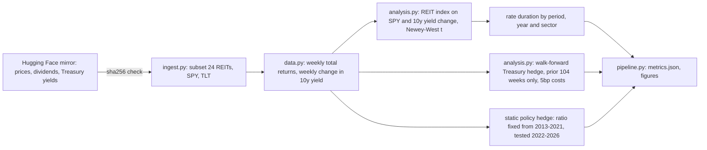

# Architecture

Modules: `ingest.py`, `data.py`, `analysis.py`, `pipeline.py`. Tests: `tests/test_analysis.py` (beta recovery, walk-forward uses past data only, hedge ratio equals the duration ratio, drawdown definition).
